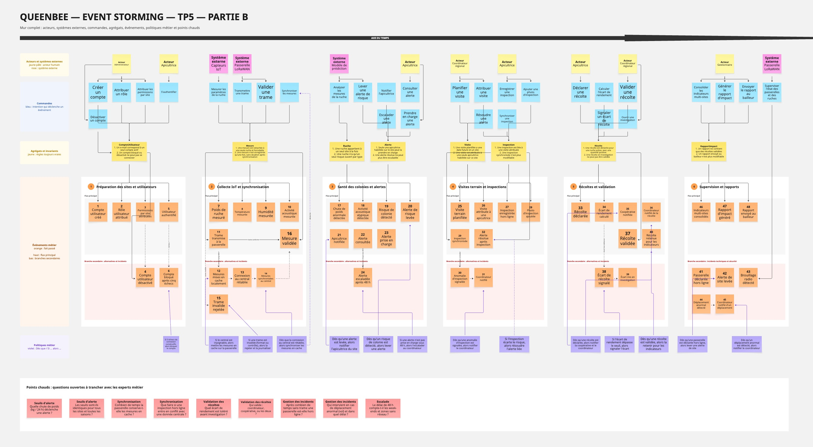
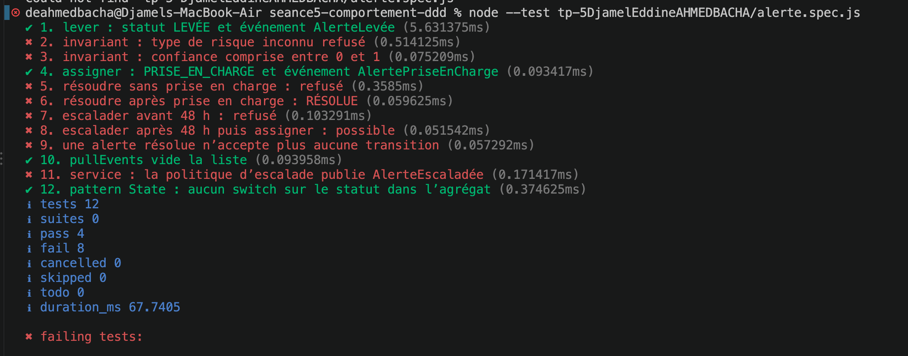
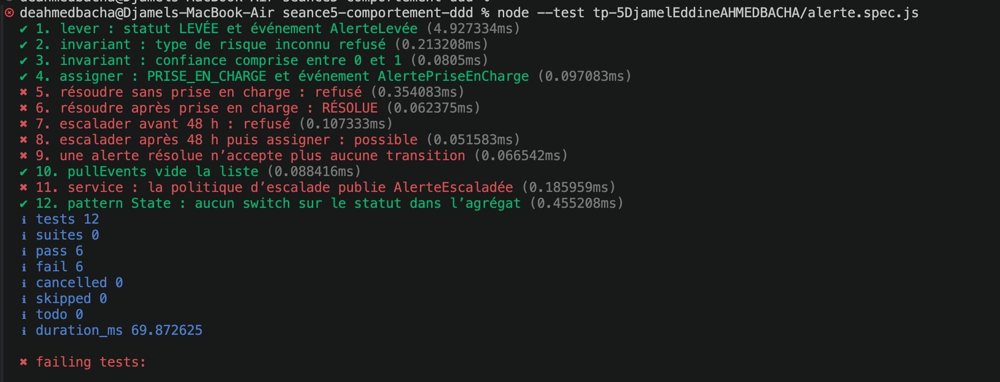
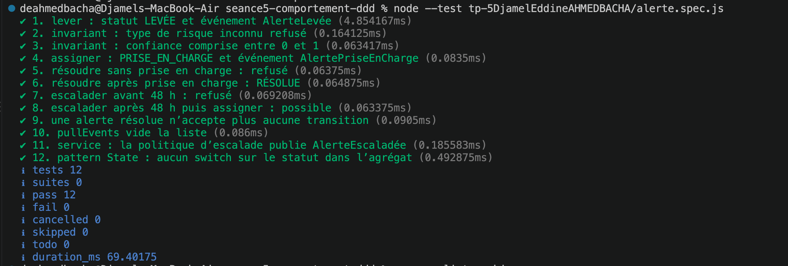
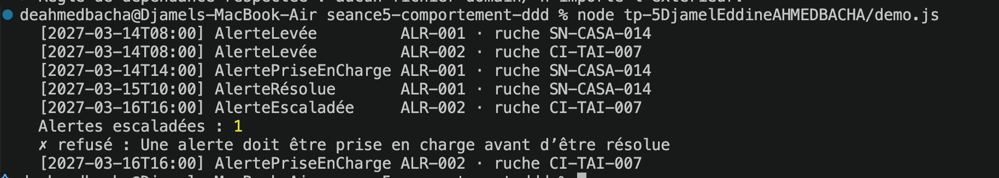

# TP5 - Event Storming QueenBee

## Membres du groupe

- Djamel Eddine Ahmed Bacha
- Yaya Mohamedhen
- Ayadi Firas
- Mohammed BENBRAHIM

## Mur Event Storming

## Tests

on a commencé avec 4 tests réussis sur 12, puis corrigé les TODO de Alerte.js.

### Tests au début

### Première correction

### Deuxième correction

### Résultat final - 12/12

## Démonstration

on a testé le cycle de vie des alertes avec deux ruches.

une alerte est prise en charge puis résolue, et l'autre est escaladée après 48h.

