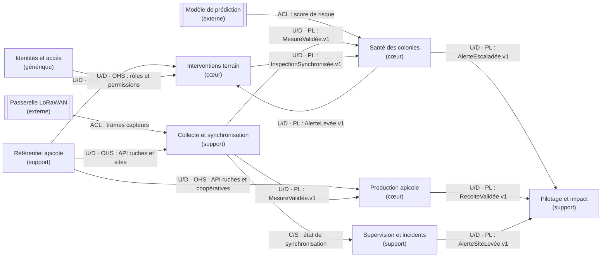

# context map queenbee - tp5

on a relié nos 8 bounded contexts pour voir qui fournit les données et qui en a besoin.
les flèches vont du contexte qui fournit l'information vers celui qui la reçoit.

## diagramme

## relations entre les contextes

| Amont | Aval | Relation | Ce qui est échangé | Pourquoi |
|---|---|---|---|---|
| Collecte et synchronisation | Santé des colonies | U/D · PL | `MesureValidée.v1` | les mesures servent à détecter les risques. |
| Santé des colonies | Interventions terrain | U/D · PL | `AlerteLevée.v1` | une alerte peut déclencher une visite. |
| Référentiel apicole | Production apicole | U/D · OHS | API ruches et coopératives | on doit savoir à quelle ruche appartient une récolte. |
| Passerelle LoRaWAN | Collecte et synchronisation | ACL | trames capteurs | on adapte les données reçues au format de QueenBee. |
| Production apicole | Pilotage et impact | U/D · PL | `RecolteValidée.v1` | les récoltes validées alimentent les indicateurs. |
| Identités et accès | Interventions terrain | U/D · OHS | rôles et permissions | on vérifie qui peut enregistrer une inspection. |
| Interventions terrain | Santé des colonies | U/D · PL | `InspectionSynchronisée.v1` | une inspection peut permettre de résoudre une alerte. |
| Référentiel apicole | Collecte et synchronisation | U/D · OHS | API ruches et sites | on vérifie à quelle ruche appartient une mesure. |
| Supervision et incidents | Pilotage et impact | U/D · PL | `AlerteSiteLevée.v1` | les problèmes techniques comptent dans le suivi des sites. |
| Modèle de prédiction | Santé des colonies | ACL | score de risque | on transforme le résultat du modèle en risque métier. |
| Collecte et synchronisation | Production apicole | U/D · PL | `MesureValidée.v1` | le poids mesuré aide à vérifier une récolte. |
| Santé des colonies | Pilotage et impact | U/D · PL | `AlerteEscaladée.v1` | on peut suivre les alertes critiques. |
| Référentiel apicole | Interventions terrain | U/D · OHS | API ruches | on identifie les ruches concernées par les visites. |
| Collecte et synchronisation | Supervision et incidents | C/S | état de synchronisation | la supervision a besoin de savoir si les sites transmettent encore. |

## types de relations

- **U/D** : un contexte fournit des informations à un autre.
- **OHS** : un contexte met à disposition une API pour les autres.
- **PL** : on partage des événements avec un format défini.
- **ACL** : on adapte le format d'un système externe pour éviter de mélanger ses données avec notre modèle.
- **C/S** : le contexte qui utilise les informations peut demander des évolutions à celui qui les fournit.

## pourquoi ce découpage ?

on a pas mis tous les contextes dans un seul bloc, sinon ça devient compliqué à gérer.

par exemple, `Santé des colonies` reçoit les mesures validées, mais ne gère pas lui-même les capteurs. c'est le travail de `Collecte et synchronisation`.

une alerte pour une colonie et une alerte de passerelle, c'est pas pareil non plus. c'est pour ça qu'on les a séparées.

l'inspection reste dans `Interventions terrain`, et c'est `Santé des colonies` qui décide si une alerte peut être résolue.

## points à confirmer

- les noms avec `.v1` sont des contrats d'événements proposés pour l'architecture, pas des API déjà codées.
- la relation C/S sur l'état de synchronisation est une proposition à valider avec les autres équipes.
- on garde le `Référentiel apicole` même s'il n'a pas encore d'événement dédié sur nos 48 post-it, parce que les autres contextes utilisent ses références.
