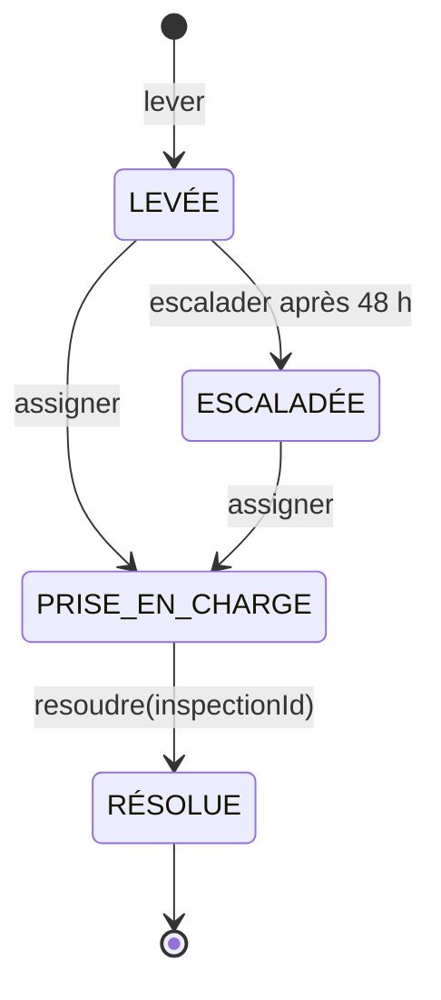

# tp5 - agrégat Alerte (parcours dev)

## à quoi ça sert

on a travaillé sur l'agrégat `Alerte`, qui appartient au contexte **Santé des colonies**.
il sert à suivre un risque détecté sur une ruche, depuis sa création jusqu'à sa résolution.
on a utilisé le pattern **State** pour éviter de gérer tous les statuts avec des `if` ou un `switch`.

## cycle de vie

une alerte peut être assignée directement. si personne la prend en charge pendant 48 h, elle passe à l'état `ESCALADÉE`.
après une inspection, l'alerte peut être résolue. une fois résolue, on ne peut plus changer son état.

## invariants et règles

- le type de risque doit être dans la liste : `ESSAIMAGE`, `AFFAIBLISSEMENT`, `STRESS_THERMIQUE`, `MORTALITE`.
- la confiance doit être un nombre compris entre 0 et 1.
- une alerte `LEVÉE` ne peut pas être résolue sans prise en charge.
- l'escalade est possible uniquement après 48 h sans prise en charge.
- une alerte déjà prise en charge ne peut pas être assignée une deuxième fois ni escaladée.
- pour résoudre une alerte, il faut un `inspectionId`.
- une alerte `ESCALADÉE` doit d'abord être assignée avant d'être résolue.
- une alerte `RÉSOLUE` refuse toutes les nouvelles transitions.

## événements publiés

| Événement | Quand il est produit |
|---|---|
| `AlerteEscaladée` | l'alerte est toujours sans prise en charge après 48 h. |
| `AlerteLevée` | un nouveau risque est détecté pour une ruche. |
| `AlerteRésolue` | une inspection permet de terminer le traitement. |
| `AlertePriseEnCharge` | une apicultrice est affectée à l'alerte. |

les événements sont enregistrés dans l'agrégat, puis récupérés avec `pullEvents()`.
le service `AlerteService` les publie sur l'`EventBus`. dans la démo, un observateur écoute ces événements et les affiche.

## où placer cet agrégat dans la context map

- **Contexte propriétaire :** `Santé des colonies`. c'est lui qui publie `AlerteLevée` et `AlerteEscaladée`.
- **En entrée :** il utilise les mesures validées du contexte `Collecte et synchronisation` et les résultats du modèle de prédiction pour identifier un risque.
- **Vers Interventions terrain :** `AlerteLevée` permet d'organiser une visite. en retour, une inspection réalisée peut aider à résoudre l'alerte.
- **Vers Pilotage et impact :** `AlerteEscaladée` peut servir au suivi des colonies à risque et des alertes critiques.

ces échanges décrivent l'architecture prévue : le kit du TP5 code surtout l'agrégat, le service et la publication sur l'EventBus, pas tous les autres contextes.

